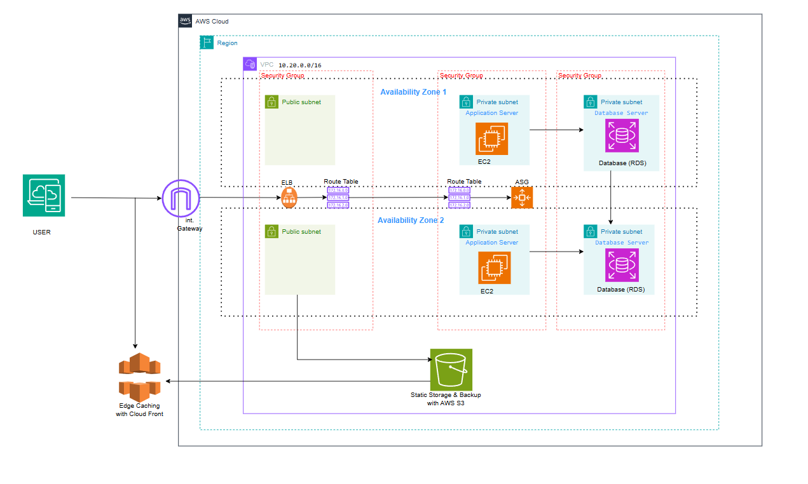

# aws-infrastructure-automation

# Nova Retail – AWS Infrastructure Automation

## Project Overview

Nova Retail is a cloud infrastructure design project focused on building a secure, scalable, and cost-conscious AWS environment using Infrastructure as Code (IaC).

The project demonstrates the design of a multi-Availability Zone AWS architecture for a fictional retail organisation, following cloud infrastructure best practices.

The infrastructure is designed to support application hosting, database services, network isolation, and secure communication between AWS resources.

## Architecture

The architecture uses an Amazon Virtual Private Cloud (VPC) with public and private subnets distributed across two Availability Zones in the AWS Africa (Cape Town) region (`af-south-1`).

### Architecture Components

| AWS Service | Purpose |
|---|---|
| Amazon VPC | Provides an isolated cloud network |
| Public Subnets | Host internet-facing infrastructure |
| Private Subnets | Host application and database resources |
| Internet Gateway | Provides internet connectivity to public resources |
| Application Load Balancer | Distributes incoming application traffic |
| Amazon EC2 | Hosts application workloads |
| Auto Scaling Group | Manages application instance capacity |
| Amazon RDS | Provides managed relational database services |
| Amazon S3 | Provides object storage |
| S3 Gateway Endpoint | Enables private access to S3 |
| Security Groups | Control inbound and outbound traffic |

## Network Design

- VPC CIDR: `10.20.0.0/16`
- Two Availability Zones
- Two public subnets
- Two private subnets
- Internet Gateway for public subnet connectivity
- Separate public and private route tables

Private resources are not directly exposed to the public internet.

## Security Considerations

The architecture incorporates network segmentation and controlled access through:

- Public and private subnet separation.
- Security Groups to restrict network traffic.
- Private application and database workloads.
- Controlled access to Amazon S3 through a Gateway Endpoint.
- No direct public access to database resources.

## Cost Optimisation

The architecture intentionally excludes a NAT Gateway to avoid unnecessary recurring infrastructure costs.

Private subnet resources do not have direct outbound internet connectivity in the initial design.

## Infrastructure as Code

Terraform will be used to define and provision AWS infrastructure.

GitHub will be used for source control and project documentation.

## Project Status

**Current phase:** Architecture design completed.

**Upcoming activities:**
- Terraform infrastructure configuration.
- AWS resource provisioning.
- Network and security validation.
- Infrastructure testing.
- Documentation of deployment and operational procedures.

### Architecture Diagram

## Network Traffic Flow

The Nova Retail architecture uses a controlled traffic flow to protect application and database resources.

### 1. Incoming Application Traffic

1. External users access the application over the internet.
2. Traffic reaches the Application Load Balancer (ALB) through the Internet Gateway.
3. The ALB forwards requests to healthy EC2 instances in the private application subnets.

### 2. Application Processing

1. EC2 instances receive application requests from the ALB.
2. The application processes incoming requests.
3. When database access is required, the application communicates with the Amazon RDS database through its private network connection.

### 3. Database Communication

- Amazon RDS is deployed in private subnets.
- Database access is restricted through Security Groups.
- The database is not directly accessible from the public internet.
- Only authorised application resources should be allowed to communicate with the database.

### 4. Amazon S3 Communication

The application can access Amazon S3 through an S3 Gateway VPC Endpoint.

This allows supported S3 traffic to remain on the AWS network without requiring a public internet route or NAT Gateway.

### 5. Internet Connectivity Considerations

The initial architecture does not include a NAT Gateway.

Consequently, EC2 instances in private subnets do not have general outbound internet access. This is an intentional cost-saving decision in the initial design.

If outbound internet connectivity becomes necessary, a NAT Gateway or another suitable egress solution can be introduced.
## Disclaimer

This is an independent educational and portfolio project developed using a personal AWS account. It is not affiliated with any employer or client organisation.
